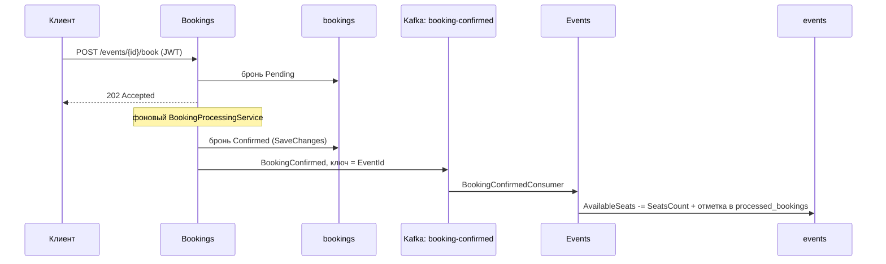

# ProjectWork — спринт 9

Учебная система бронирования на C# / .NET 10 / ASP.NET Core / EF Core / PostgreSQL / Apache Kafka.
Монолит разделён на три самостоятельных сервиса, которые обмениваются данными только через Kafka.
Репозиторий: [practicum_project](https://github.com/vvvotodefff/practicum_project).

## Сервисы

| Сервис | Ответственность | Swagger | Своя PostgreSQL (с хоста) |
| --- | --- | --- | --- |
| Users | Регистрация, вход, выдача JWT | http://localhost:5250/swagger | localhost:5441 / users |
| Events | CRUD событий, учёт свободных мест, подписчик Kafka | http://localhost:5251/swagger | localhost:5442 / events |
| Bookings | Создание, чтение, отмена и фоновое подтверждение броней, издатель Kafka | http://localhost:5252/swagger | localhost:5443 / bookings |

Инфраструктура: Zookeeper, Kafka (`localhost:9092` с хоста, `kafka:29092` внутри сети Docker).

Каждый сервис построен по чистой архитектуре (Domain, Application, Infrastructure,
Presentation), имеет свою базу и свои миграции EF Core. Сервисы не вызывают друг
друга по HTTP и не читают чужие таблицы: Bookings хранит только внешние
идентификаторы EventId и UserId, без навигаций и внешних ключей.

## Запуск

### Вся система в Docker

Нужен Docker Desktop с Linux-контейнерами. В корне репозитория:

```powershell
docker compose up -d --build
```

Поднимаются Zookeeper, Kafka, три PostgreSQL и три сервиса. Каждый сервис при старте
применяет свои миграции; Events дополнительно создаёт топик `booking-confirmed`.
Сервисы ждут готовности своих БД и Kafka (healthcheck).

Остановка без удаления данных — `docker compose down`, с удалением томов — `docker compose down -v`.

Настройки сервисов в контейнерах передаются переменными окружения из
[docker-compose.yml](docker-compose.yml) (`Секция__Ключ` переопределяет `appsettings.json`):
строки подключения указывают на `users-db`/`events-db`/`bookings-db`, Kafka — на `kafka:29092`.
JWT-секрет общий для трёх сервисов; по умолчанию используется учебное значение,
своё можно задать переменной `JWT_SECRET` перед `docker compose up`.

Образы собираются многоступенчатыми Dockerfile (`Services/<Сервис>/Dockerfile`, контекст —
корень репозитория): SDK для restore/publish, `aspnet:10.0` для запуска от непривилегированного пользователя.

### Сервисы локально

Нужен .NET SDK 10. Поднимите только инфраструктуру и запустите сервисы из трёх терминалов:

```powershell
docker compose up -d --wait zookeeper kafka users-db events-db bookings-db
```

```powershell
dotnet run --project Services/Users/ProjectWork.Users.Presentation --launch-profile http
```

```powershell
dotnet run --project Services/Events/ProjectWork.Events.Presentation --launch-profile http
```

```powershell
dotnet run --project Services/Bookings/ProjectWork.Bookings.Presentation --launch-profile http
```

Профиль `http` использует окружение Development: учебный JWT-ключ берётся из
`appsettings.Development.json`, БД — `localhost:5441–5443` (postgres / postgres),
Kafka — `localhost:9092`. В базовом `appsettings.json` секрет пуст, поэтому
Production без явно заданного `Jwt__Secret` не запустится.
В Visual Studio откройте ProjectWork.slnx и назначьте три проекта Presentation запускаемыми.

### Настройки

| Ключ | Сервисы | Назначение |
| --- | --- | --- |
| `ConnectionStrings:DefaultConnection` | все | Своя база сервиса |
| `Jwt:Secret`, `Jwt:Issuer`, `Jwt:Audience` | все | Должны совпадать во всех трёх сервисах |
| `Jwt:LifetimeMinutes` | Users | Время жизни выдаваемого токена |
| `Kafka:BootstrapServers` | Events, Bookings | Адрес брокера |
| `Kafka:ConsumerGroup` | Events | Группа потребителей (`events-group`) |

## Поток BookingConfirmed



**Кто публикует.** Bookings. Фоновый `BookingProcessingService` переводит брони из Pending
в Confirmed, сначала сохраняет статус в свою базу и только после этого публикует
сообщение через `IBookingEventPublisher` (реализация — `KafkaBookingEventPublisher`).
Producer один на приложение (singleton), при остановке выполняет Flush и Dispose.
Ключ сообщения — EventId: все брони одного события попадают в один раздел и
обрабатываются по порядку. Bookings не меняет места и не обращается к Events.

**Кто получает.** Events. `BookingConfirmedConsumer` (BackgroundService) подписан на топик
в группе `events-group`: при нескольких экземплярах Events каждое сообщение получает
только один из них. Блокирующий `Consume` работает в отдельной задаче; на каждое
сообщение создаётся свой scope для DbContext и репозиториев. До запуска подписчика
`KafkaTopicInitializer` создаёт топик (3 раздела), если его ещё нет; ошибка создания
только логируется и не роняет сервис.

**Что происходит при получении.** Сообщение десериализуется в `BookingConfirmed`,
и `EventService.ApplyBookingConfirmedAsync` уменьшает `AvailableSeats` события на
`SeatsCount`. Одновременно в таблицу `processed_bookings` записывается BookingId — в одной
операции SaveChanges с изменением мест. Поэтому:

- повторная доставка того же сообщения места повторно не списывает (идемпотентность);
- событие не найдено или мест не хватает — сообщение пропускается с предупреждением в логе;
- некорректный JSON или пустые поля — пропуск с предупреждением, подписчик не падает;
- сбой БД — сообщение не подтверждается и читается повторно через 5 секунд.

Смещение в Kafka сохраняется только после обработки сообщения.

Формат сообщения и топик описаны в общем проекте
[Shared/ProjectWork.Contracts](Shared/ProjectWork.Contracts/README.md), который подключают и Bookings, и Events.

## API

| Сервис | Метод и маршрут | Доступ / результат |
| --- | --- | --- |
| Users | POST /auth/register | Публично, 204; ошибка 400 |
| Users | POST /auth/login | Публично, 200 с полем token; ошибка 400 |
| Events | GET /events | Публично, фильтры title/from/to, пагинация page/pageSize |
| Events | GET /events/{id} | Публично, 200 / 404 |
| Events | POST /events | Admin, 201 с Location |
| Events | PUT /events/{id} | Admin, 204 / 404 |
| Events | DELETE /events/{id} | Admin, 204 / 404 |
| Bookings | POST /events/{id}/book | Авторизованный пользователь, 202 с Location |
| Bookings | GET /bookings/{id} | Владелец или Admin; чужая и отсутствующая бронь дают 404 |
| Bookings | DELETE /bookings/{id} | Владелец или Admin, 204; чужая — 403 |

Создание брони отправляется **на порт Bookings (5252)**, хотя путь начинается с /events.

JWT выдаёт только Users; Events и Bookings проверяют подпись, срок, издателя, аудиторию
и claims (`sub` — идентификатор пользователя, `role` — User или Admin). Без токена — 401,
без роли Admin на управлении событиями — 403. Swagger каждого сервиса поддерживает
кнопку Authorize: вставьте token из `/auth/login` без префикса Bearer.

Лимит — 10 активных броней пользователя (Pending и Confirmed). Повторная отмена безопасна.
Title обязателен (до 200 символов), Description — до 2000, EndAt > StartAt, TotalSeats > 0.
Время хранится в UTC. Ошибки возвращаются в формате Problem Details.

## Проверка сценария

На запущенной в Docker системе:

```powershell
./scripts/Verify-Docker.ps1
```

Скрипт регистрирует Admin и User в Users, проверяет 403/401, создаёт событие на 5 мест
в Events, бронирует место в Bookings и ждёт, пока бронь станет Confirmed, а в Events
останется 4 места — уменьшение приходит только через Kafka.

То же вручную через Swagger: зарегистрируйтесь в Users (`role: Admin`), получите token,
создайте событие в Events, под токеном пользователя забронируйте его в Bookings,
через пару секунд проверьте статус брони и `availableSeats` события.

Посмотреть сообщения в топике:

```powershell
docker exec -it eventapi-kafka kafka-console-consumer --bootstrap-server localhost:29092 --topic booking-confirmed --from-beginning --property print.key=true
```

## Ограничения

- Сохранение брони и публикация не составляют общей транзакции: при сбое между ними бронь
  останется Confirmed без сообщения. Гарантированная доставка требует Transactional Outbox.
- Bookings не знает, существует ли событие и есть ли места: бронь подтверждается сразу,
  а Events при нехватке мест только пропускает сообщение. Отказа брони и возврата мест
  при отмене нет — для этого нужны дополнительные сообщения.
- Удаление события не затрагивает брони в другой базе.
- Учебные упрощения из спринта 8: регистрация позволяет выбрать роль Admin, пароли хешируются
  SHA-256 без соли. Семафоры защищают изменения только внутри одного процесса.

## Структура

```text
Services/
  Users/     Domain, Application, Infrastructure, Presentation, Dockerfile
  Events/    Domain, Application, Infrastructure (+ Messaging: подписчик, создание топика), Presentation, Dockerfile
  Bookings/  Domain, Application, Infrastructure (+ Messaging: издатель), Presentation, Dockerfile
Shared/
  ProjectWork.Contracts/   BookingConfirmed и имя топика
ProjectWork.Tests/               unit-тесты
ProjectWork.IntegrationTests/    репозитории и миграции на PostgreSQL
ProjectWork.PresentationTests/   HTTP, JWT, Kafka
scripts/
docker-compose.yml
ProjectWork.slnx
```

Domain не зависит от других слоёв; Application зависит от своего Domain (Events и Bookings —
также от Contracts); Infrastructure реализует порты Application; Presentation подключает
свои Application и Infrastructure. Между сервисами нет ProjectReference.

## Миграции

- Users: InitialCreate — `users`.
- Events: InitialCreate — `events`; AddProcessedBookings — `processed_bookings` для идемпотентности.
- Bookings: InitialCreate — `bookings`, без FK в чужие базы.

Новая миграция (для других сервисов замените Users):

```powershell
dotnet ef migrations add MigrationName --project Services/Users/ProjectWork.Users.Infrastructure --startup-project Services/Users/ProjectWork.Users.Presentation --context UsersDbContext --output-dir Persistence/Migrations
```

## Тесты

```powershell
dotnet test ProjectWork.slnx --configuration Release --verbosity minimal
```

- ProjectWork.Tests: доменные правила, сервисы, JWT, зависимости слоёв, порядок
  сохранения и публикации, идемпотентное применение подтверждений в Events.
- ProjectWork.IntegrationTests: репозитории и миграции каждого сервиса на PostgreSQL.
- ProjectWork.PresentationTests: три HTTP-конвейера, 401/403/404, совпадение JWT-настроек
  сервисов, Swagger. `KafkaPublicationTests` — публикация из Bookings на настоящем брокере;
  `KafkaSubscriptionTests` — Events на пустом брокере создаёт топик и списывает места
  ровно один раз, пропуская дубликат и некорректное сообщение.

Тесты сами поднимают временные контейнеры PostgreSQL и Kafka со случайными портами и
не трогают базы compose. Только Kafka-тесты: `--filter Category=Kafka`.
CI ([.github/workflows/ci.yml](.github/workflows/ci.yml)) собирает решение и запускает тесты
при push в main/sprint-* и PR в main.
